# CetakPintar

Jana lembaran kerja matematik dan abjad A4 yang sedia dicetak untuk murid prasekolah dan sekolah rendah, lengkap dengan skema jawapan. Termasuk lembaran abjad dan teka gambar mengikut tema (haiwan, buah-buahan, kenderaan, sukan). Tersedia sebagai aplikasi web yang mudah dikongsi dan antara muka baris perintah (CLI).

[English version below](#cetakpintar-english)

---

## Bahasa Melayu

### Apa Itu CetakPintar?

CetakPintar ialah alat sumber terbuka percuma untuk menghasilkan lembaran kerja latihan matematik dan abjad dalam format PDF bersaiz A4. Setiap helaian dijana secara dinamik dan disertakan skema jawapan lengkap di bahagian belakang, memudahkan ibu bapa serta guru membuat semakan pantas.

Ciri-ciri utama:
* **Penjanaan dinamik tanpa pangkalan data:** Semua konfigurasi disimpan dalam URL. Tiada akaun pengguna atau storan fail diperlukan.
* **Skema jawapan disertakan:** Setiap helaian latihan mempunyai helaian jawapan yang sepadan, termasuk jalan kerja bentuk lazim untuk bahagi.
* **Boleh dikongsi dengan mudah:** Pautan yang dihasilkan membolehkan sesiapa sahaja mencetak semula lembaran kerja yang sama.
* **Dwibahasa:** Menyokong Bahasa Melayu dan Bahasa Inggeris untuk arahan dan antara muka.
* **Format sedia cetak:** Susun atur kemas hitam putih bersaiz standard A4, jimat dakwat pencetak.

---

### Tangkap Layar dan Contoh Lembaran

#### Antara Muka Web

Borang interaktif membolehkan anda memilih topik, bilangan halaman, bahasa, dan pratetap dengan pantas:

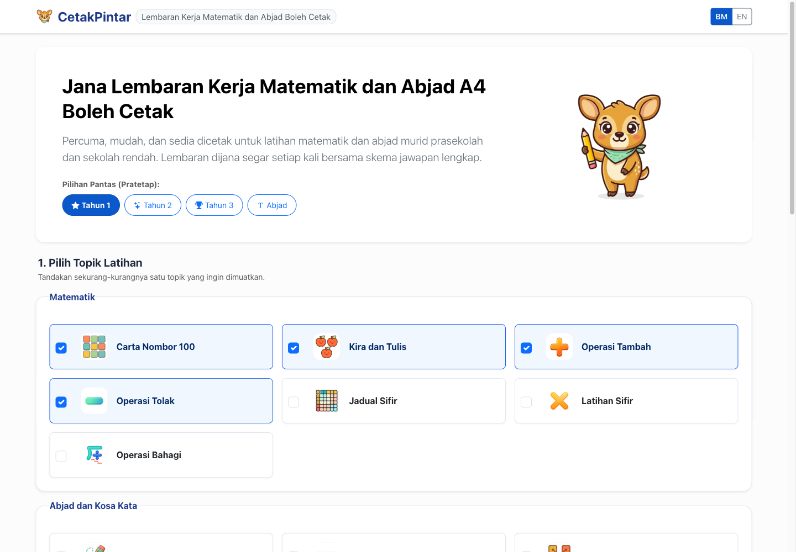

#### Contoh Lembaran Latihan dan Skema Jawapan

Berikut adalah contoh halaman latihan pertama dan halaman jawapan bagi setiap pratetap yang dijana terus oleh aplikasi:

| Pratetap | Lembaran Latihan | Skema Jawapan |
|---|---|---|
| **Tahun 1 (t1)** | 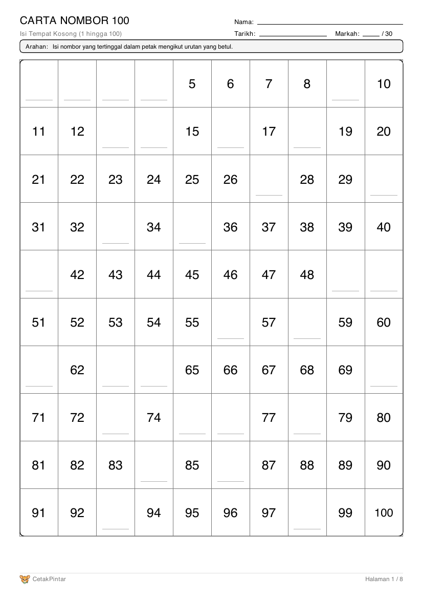 | 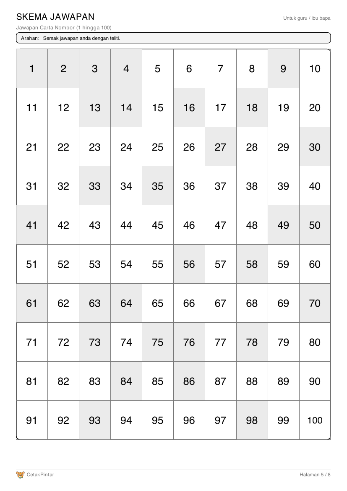 |
| **Tahun 2 (t2)** | 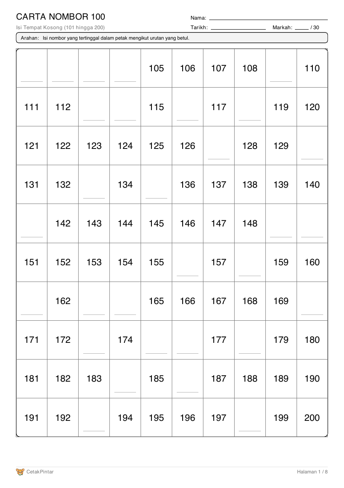 | 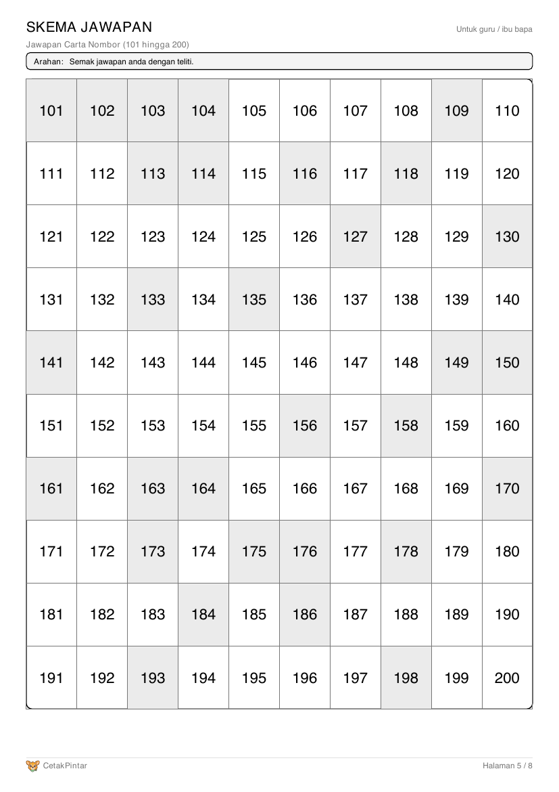 |
| **Tahun 3 (t3)** | 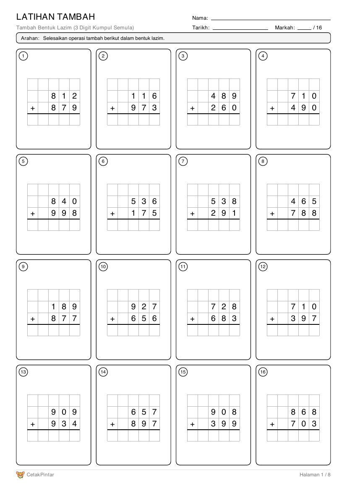 | 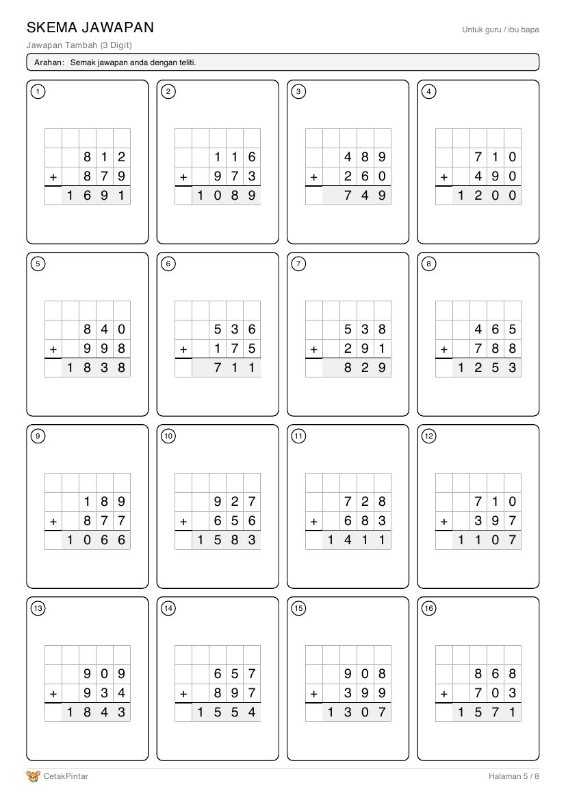 |
| **Abjad (abc)** | 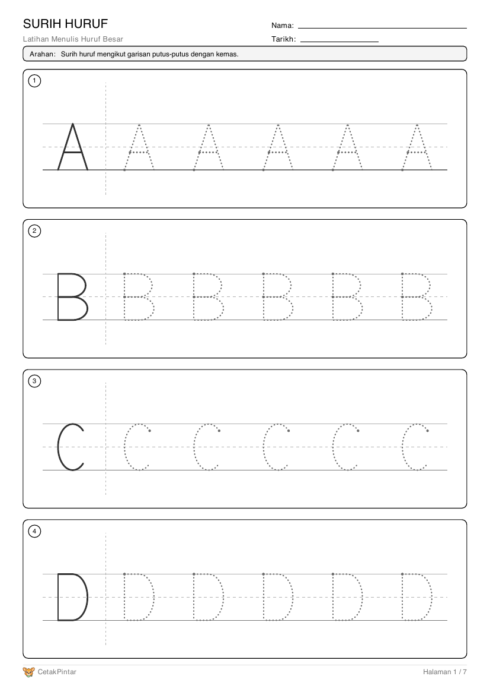 | 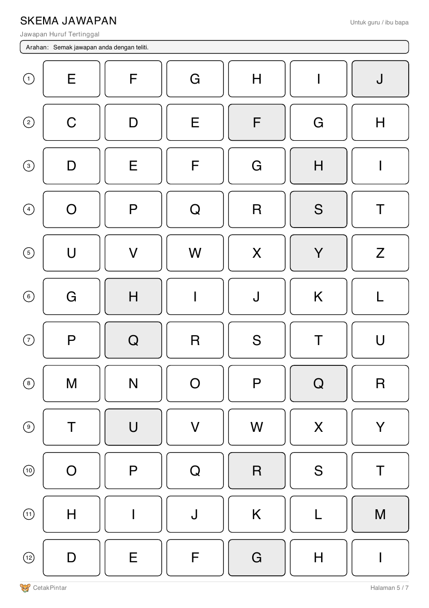 |
| **Teka Perkataan (guess_word)** | 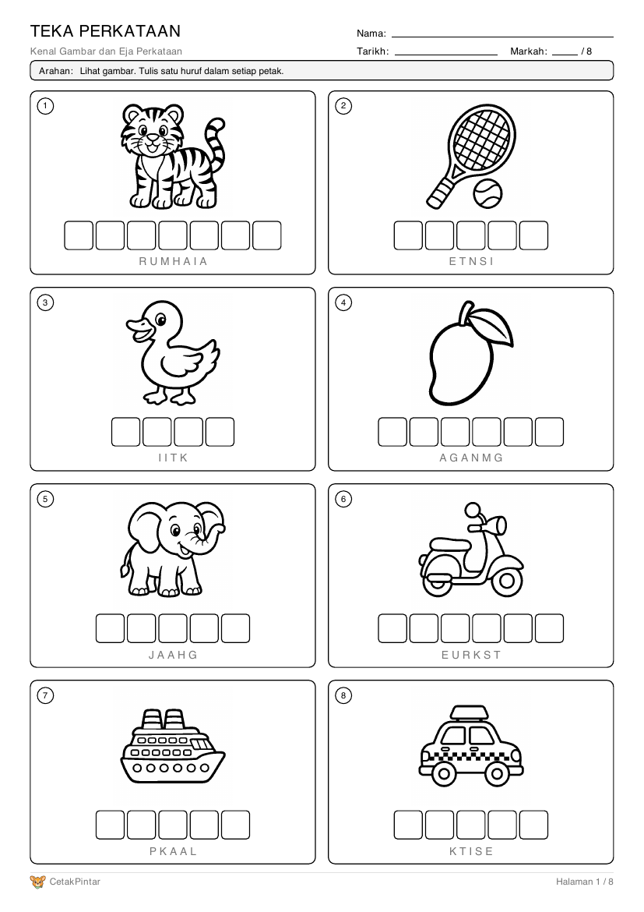 | 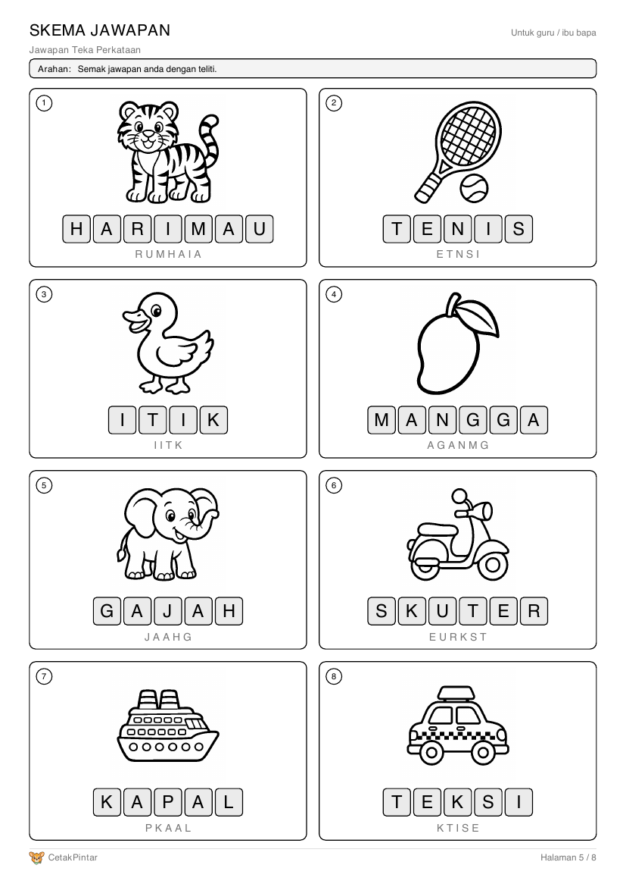 |

---

### Mula Pantas

#### 1. Menjalankan Aplikasi Web dengan uv

Pastikan anda telah memasang `uv` (pengurus pakej Python yang pantas):

```bash
# Salin repositori dan pasang kebergantungan
uv sync

# Sediakan fail konfigurasi persekitaran
cp .env.example .env

# Jalankan pelayan pembangunan
uv run python cetak_pintar.py
```

Buka pelayar web anda di `http://localhost:5000`.

Untuk menjalankan dalam mod pengeluaran (production) menggunakan Waitress:

```bash
APP_ENV=production SECRET_KEY="kunci-rahsia-anda" uv run python cetak_pintar.py
```

#### 2. Menjana PDF melalui Baris Perintah (CLI)

Anda boleh menjana PDF terus tanpa membuka pelayar web menggunakan fail `cli.py`:

```bash
# Jana lembaran kerja menggunakan pratetap t1
uv run python cli.py --preset t1 --seed 42 -o latihan-t1.pdf

# Gabungkan topik tambah dan tolak 2 digit dengan kumpul semula
uv run python cli.py --topics add,sub --add-digits 2 --add-regroup --sub-digits 2 --sub-borrow --pages 4 -o tambah-tolak.pdf

# Latihan sifir (jadual 2, 3, dan 5) tanpa skema jawapan
uv run python cli.py --topics sifir --sifir-tables 2,3,5 --sifir-n 12 --no-answers -o sifir.pdf

# Lembaran mengira objek bergambar (maksimum 10 objek)
uv run python cli.py --topics count --count-max 10 --pages 2 -o kira-objek.pdf

# Pratetap abjad (surih, huruf tertinggal, padankan, huruf pertama)
uv run python cli.py --preset abc --seed 7 -o abjad.pdf

# Teka perkataan bertema haiwan dan kenderaan, tanpa petunjuk huruf, dalam Bahasa Inggeris
uv run python cli.py --topics guess_word --themes animals,vehicles --guess-hint 0 --lang en --pages 2 -o teka-perkataan.pdf
```

#### 3. Menggunakan Docker

CetakPintar menyediakan imej Docker ringan yang dikuasakan oleh pelayan Waitress:

```bash
# Bina imej Docker
docker build -t cetak-pintar .

# Jalankan kontena (wajib membekalkan SECRET_KEY untuk mod pengeluaran)
docker run -d -p 5000:5000 -e SECRET_KEY="kunci-rahsia-pengeluaran-anda" --name cetak-pintar-app cetak-pintar
```

Aplikasi sedia diakses di `http://localhost:5000`.

---

### Jenis Lembaran Kerja

CetakPintar menawarkan tujuh topik matematik dan lima topik abjad.

#### Matematik

| Kod Topik | Nama Topik | Penerangan dan Julat Pilihan |
|---|---|---|
| `grid` | Carta Nombor | Carta 100 nombor berturutan dengan petak kosong untuk diisi. Pilihan nombor mula (1, 101, 201, ..., 901) dan 15 hingga 60 petak kosong. |
| `count` | Kira Objek Bergambar | Soalan mengira objek vektor comel (bintang, bulatan, epal, ikan, bunga) untuk membina asas membilang nombor sehingga 5, 10, atau 20 objek. |
| `add` | Tambah Bentuk Lazim | Operasi penambahan 1, 2, atau 3 digit. Boleh ditetapkan sama ada memerlukan kumpul semula (carry over) atau tanpa kumpul semula. |
| `sub` | Tolak Bentuk Lazim | Operasi penolakan 1, 2, atau 3 digit. Boleh ditetapkan sama ada memerlukan pinjam/kumpul semula (borrowing) atau tanpa pinjam. |
| `sifir_ref` | Sifir Rujukan | Jadual sifir darab rujukan 1 hingga 12 yang padat (6 sifir setiap halaman), memudahkan rujukan murid tanpa helaian jawapan. |
| `sifir` | Latihan Sifir | Latihan tubi sifir darab terpilih (daripada sifir 1 hingga 12). Bilangan soalan setiap helaian boleh dilaraskan sehingga 24 soalan. |
| `div` | Bahagi Bentuk Lazim | Operasi bahagi bentuk lazim untuk dividen 2 atau 3 digit dengan pembahagi 2 hingga 9. Menyokong pembahagian tepat atau berbaki. Skema jawapan memaparkan jalan kerja lajur penuh langkah demi langkah. |

#### Abjad dan kosa kata

| Kod Topik | Nama Topik | Penerangan dan Julat Pilihan |
|---|---|---|
| `trace` | Surih Huruf | Empat huruf setiap halaman, satu huruf contoh diikuti huruf putus-putus untuk disurih. Halaman seterusnya menyambung abjad dan berulang selepas Z. Pilihan huruf besar atau huruf kecil (`abc_case`). Tiada skema jawapan. |
| `missing` | Huruf Tertinggal | 12 baris huruf berturutan dengan 1, 2, atau 3 petak kosong setiap baris (`missing_blanks`). Mengikut pilihan huruf besar atau kecil. |
| `match` | Padankan Huruf | Tiga set setiap halaman. Murid melukis garisan untuk memadankan 6 huruf besar dengan huruf kecil yang sepadan. |
| `first_letter` | Huruf Pertama | 12 gambar setiap halaman. Murid menulis huruf pertama nama gambar. Skema jawapan memaparkan perkataan penuh. |
| `guess_word` | Teka Perkataan | 8 gambar setiap halaman dengan satu petak bagi setiap huruf. Huruf yang dikacau boleh dipaparkan di bawah petak sebagai petunjuk (`guess_hint`, 1 untuk ya, 0 untuk tidak). |

Topik `first_letter` dan `guess_word` menggunakan 48 lukisan garis hitam putih dalam empat tema (`themes`): haiwan (`animals`), buah-buahan (`fruits`), kenderaan (`vehicles`), dan sukan (`sports`). Pilih satu atau lebih tema. Perkataan mengikut bahasa lembaran, contohnya KUCING dalam Bahasa Melayu dan CAT dalam Bahasa Inggeris.

---

### Pratetap Tersedia

Untuk memudahkan pemilihan, empat pratetap disediakan. Tiga untuk matematik berasaskan julat sebenar topik sekolah rendah, dan satu untuk abjad:

* **Pratetap t1 (Diinspirasikan oleh topik Tahun 1):**
  * Julat dan kandungan: Carta nombor 1 hingga 100 (30 petak kosong), kira objek bergambar (sehingga 10 objek), tambah 1 digit tanpa kumpul semula, tolak 1 digit tanpa pinjam.
  * Halaman: 4 halaman kandungan (carta, kira objek, tambah, tolak) dan 4 halaman skema jawapan.

* **Pratetap t2 (Diinspirasikan oleh topik Tahun 2):**
  * Julat dan kandungan: Carta nombor 101 hingga 200 (30 petak kosong), tambah 2 digit dengan kumpul semula, tolak 2 digit dengan pinjam, latihan sifir 2, 3, 4, 5, dan 10 (12 soalan).
  * Halaman: 4 halaman kandungan dan 4 halaman skema jawapan.

* **Pratetap t3 (Diinspirasikan oleh topik Tahun 3):**
  * Julat dan kandungan: Tambah 3 digit dengan kumpul semula, tolak 3 digit dengan pinjam, latihan sifir 6, 7, 8, dan 9 (12 soalan), bahagi 2 digit tepat dengan pembahagi 2 hingga 9 tanpa baki.
  * Halaman: 4 halaman kandungan dan 4 halaman skema jawapan.

* **Pratetap abc (Abjad, untuk prasekolah dan Tahun 1):**
  * Julat dan kandungan: Surih huruf besar, huruf tertinggal (1 petak setiap baris), padankan huruf besar dan kecil, huruf pertama dengan gambar daripada keempat-empat tema.
  * Halaman: 4 halaman kandungan dan 3 halaman skema jawapan (surih huruf tiada jawapan).

---

### Nota Ketetapan (Determinism)

CetakPintar direka dengan prinsip deterministik:
* Setiap lembaran kerja dijana daripada nilai benih (`seed`) rawak berangka (antara 0 hingga 2147483647).
* Parameter yang sama berserta nilai benih yang sama akan sentiasa menghasilkan fail PDF yang sama bait demi bait dalam keluaran perisian yang sama di bawah Python 3.12 dengan `uv.lock` yang ditetapkan.
* Ini membolehkan guru dan ibu bapa berkongsi pautan URL kepada orang lain dan penerima dijamin mendapat set latihan dan susunan soalan yang tepat sama.
* Pautan lama yang dikongsi sebelum penjenamaan semula masih berfungsi. Kandungan lembaran kerja yang dijana kekal sama, hanya penjenama laman dan metadata PDF bertukar kepada CetakPintar.
* Perhatian: Keluaran perisian baharu pada masa hadapan mungkin menambah baik algoritma penjanaan soalan atau susun atur ReportLab, jadi ketetapan dijamin dalam versi keluaran yang sama.

---

### Penafian Produk Kurikulum

CetakPintar ialah inisiatif sumber terbuka bebas yang dibina untuk membantu ibu bapa, guru, dan tutor menyediakan lembaran latihan matematik secara pantas dan jimat kos.

Walaupun topik dan pratetap diilhamkan daripada topik Tahun 1 hingga 3 sekolah rendah di Malaysia:
* Projek ini **bukan** produk rasmi Kementerian Pendidikan Malaysia (KPM).
* Projek ini tidak mempunyai sebarang pengesahan, endorsmen, atau perakuan jajaran kurikulum rasmi (seperti KSSR).
* Projek ini tidak mendakwa merangkumi keseluruhan silibus matematik atau persediaan peperiksaan rasmi.

---

### Menyumbang

Sumbangan daripada komuniti sentiasa dialu-alukan:
1. Pastikan persekitaran ujian bersih dan semua ujian melepasi semakan dengan arahan `uv run pytest -q`.
2. Semak kualiti kod dan pemformatan menggunakan `uv run ruff check .`.
3. Sila hantar cadangan atau pull request secara teratur.

---

### Lesen

Dilesenkan di bawah [Lesen MIT](LICENSE). Hak Cipta (c) 2026 Mohamad Khairulamirin.

---

## English

# CetakPintar (English)

Generate print-ready A4 math and alphabet worksheets for preschool and primary school children, complete with answer keys. Includes alphabet sheets and picture-word sheets by theme (animals, fruits, vehicles, sports). Available as a shareable web application and a command-line interface (CLI).

---

### What is CetakPintar?

CetakPintar is a free, open-source tool for generating clean, printable math and alphabet worksheet PDFs in standard A4 format. Every worksheet is dynamically created at runtime from a random seed and includes an answer key, making practice sessions and grading effortless for parents, teachers, and tutors.

Key features:
* **Stateless and database-free:** All worksheet options are encoded in the URL query parameters. No user accounts, database servers, or stored files are required.
* **Complete answer keys:** Every practice sheet is paired with a corresponding answer page, including step-by-step long division workings formatted in clean columns.
* **Instant link sharing:** Copying and sharing a generated URL allows anyone else to regenerate the exact same worksheet.
* **Bilingual support:** Full support for both Bahasa Melayu and English for on-screen form controls and printed worksheet instructions.
* **Printer friendly:** Thoughtfully styled in clean black-and-white vector graphics to conserve printer toner and ink.

---

### Screenshots and Sample Worksheets

#### Web Interface

The clean web form allows parents and educators to customize topics, page budgets, languages, and presets with ease:


#### Sample Practice and Answer Sheets

Below are authentic sample pages rendered directly from the application for each preset:

| Preset | Practice Sheet | Answer Sheet |
|---|---|---|
| **Tahun 1 (t1)** |  |  |
| **Tahun 2 (t2)** |  |  |
| **Tahun 3 (t3)** |  |  |
| **Alphabet (abc)** |  |  |
| **Guess the word (guess_word)** |  |  |

---

### Quick Start

#### 1. Running the Web Application with uv

Make sure you have `uv` installed on your machine:

```bash
# Clone the repository and sync dependencies
uv sync

# Create your local environment configuration
cp .env.example .env

# Run the development server
uv run python cetak_pintar.py
```

Visit `http://localhost:5000` in your browser.

To start the production server powered by Waitress:

```bash
APP_ENV=production SECRET_KEY="your-production-secret-key" uv run python cetak_pintar.py
```

#### 2. Generating PDFs with the Command-Line Interface (CLI)

You can generate worksheets directly using `cli.py` without starting a web browser:

```bash
# Generate a complete worksheet using preset t1
uv run python cli.py --preset t1 --seed 42 -o worksheet-t1.pdf

# Custom combination: 2-digit addition and subtraction with regrouping
uv run python cli.py --topics add,sub --add-digits 2 --add-regroup --sub-digits 2 --sub-borrow --pages 4 -o add-sub-practice.pdf

# Multiplication drill without answer sheets
uv run python cli.py --topics sifir --sifir-tables 2,3,5 --sifir-n 12 --no-answers -o multiplication.pdf

# Picture counting exercises up to 10 objects
uv run python cli.py --topics count --count-max 10 --pages 2 -o counting-practice.pdf

# Alphabet preset (tracing, missing letters, matching, first letter)
uv run python cli.py --preset abc --seed 7 -o alphabet.pdf

# Guess the word with animal and vehicle pictures, no letter hints, in English
uv run python cli.py --topics guess_word --themes animals,vehicles --guess-hint 0 --lang en --pages 2 -o guess-the-word.pdf
```

#### 3. Running with Docker

CetakPintar provides a lean multi-stage Docker container served by Waitress:

```bash
# Build the container image
docker build -t cetak-pintar .

# Run the container (SECRET_KEY is mandatory for production mode)
docker run -d -p 5000:5000 -e SECRET_KEY="your-production-secret-key" --name cetak-pintar-app cetak-pintar
```

Access the application at `http://localhost:5000`.

---

### Worksheet Types Table

CetakPintar supports seven math topics and five alphabet topics.

#### Math

| Topic Code | Topic Name | Description and Configurable Ranges |
|---|---|---|
| `grid` | Number Grid | A 100-number consecutive grid with missing blank cells to fill in. Start numbers: 1, 101, 201, ..., up to 901. Blanks selectable from 15 to 60 cells. |
| `count` | Picture Counting | Cheerful vector shapes (star, circle, apple, fish, flower) for young learners building early counting skills up to 5, 10, or 20 objects. |
| `add` | Column Addition | Addition worksheets with 1, 2, or 3 digits. Configurable regrouping (carrying) enforcement or no-regrouping practice. |
| `sub` | Column Subtraction | Subtraction worksheets with 1, 2, or 3 digits. Configurable borrowing enforcement or no-borrowing practice. |
| `sifir_ref` | Multiplication Reference | Compact multiplication tables covering tables 1 to 12 (6 tables per page) for quick study and desk reference. Has no answer sheets. |
| `sifir` | Multiplication Drill | Randomized multiplication questions drawn from chosen tables (1 to 12). Configurable question count up to 24 per sheet. |
| `div` | Long Division | Column-aligned long division problems with 2 or 3 digit dividends and divisors from 2 to 9. Supports exact division or required remainder. Answer keys show full intermediate subtraction steps. |

#### Alphabet and vocabulary

| Topic Code | Topic Name | Description and Configurable Ranges |
|---|---|---|
| `trace` | Letter Tracing | Four letters per page, each a solid model letter followed by dotted copies to trace. Later pages continue the alphabet and wrap after Z. Uppercase or lowercase (`abc_case`). Has no answer sheets. |
| `missing` | Missing Letters | 12 rows of consecutive letters with 1, 2, or 3 blanks per row (`missing_blanks`). Follows the uppercase or lowercase choice. |
| `match` | Match the Letters | Three sets per page. Children draw lines to match 6 uppercase letters with their lowercase pairs. |
| `first_letter` | First Letter | 12 pictures per page. Children write the first letter of each picture's name. The answer key shows the full word. |
| `guess_word` | Guess the Word | 8 pictures per page with one box per letter. Scrambled letters can be printed under the boxes as a hint (`guess_hint`, 1 for on, 0 for off). |

The `first_letter` and `guess_word` topics use 48 black-and-white line drawings in four themes (`themes`): `animals`, `fruits`, `vehicles`, and `sports`. Pick one or more. Words follow the worksheet language, for example KUCING in Bahasa Melayu and CAT in English.

---

### Presets

For convenient selection, four presets are provided. Three cover math, described by their actual ranges, and one covers the alphabet:

* **Preset t1 (Inspired by Tahun 1 topics):**
  * Scope: Number grid from 1 to 100 (30 blanks), picture counting up to 10 objects, 1-digit addition without regrouping, 1-digit subtraction without borrowing.
  * Page budget: 4 practice sheets and 4 answer sheets.

* **Preset t2 (Inspired by Tahun 2 topics):**
  * Scope: Number grid from 101 to 200 (30 blanks), 2-digit addition with regrouping, 2-digit subtraction with borrowing, multiplication tables 2, 3, 4, 5, and 10 (12 problems per page).
  * Page budget: 4 practice sheets and 4 answer sheets.

* **Preset t3 (Inspired by Tahun 3 topics):**
  * Scope: 3-digit addition with regrouping, 3-digit subtraction with borrowing, multiplication tables 6, 7, 8, and 9 (12 problems per page), 2-digit exact division with divisors 2 to 9 and zero remainder.
  * Page budget: 4 practice sheets and 4 answer sheets.

* **Preset abc (Alphabet, for preschool and Tahun 1):**
  * Scope: Uppercase letter tracing, missing letters (1 blank per row), uppercase and lowercase matching, first letter with pictures from all four themes.
  * Page budget: 4 practice sheets and 3 answer sheets (tracing has no answer sheet).

---

### Determinism Note

CetakPintar guarantees deterministic document generation:
* Every worksheet is generated from a numeric random seed (ranging from 0 to 2147483647).
* The identical normalized parameters and seed produce the exact same byte-identical PDF output within the same software release on Python 3.12 with the locked dependencies in `uv.lock`.
* When a teacher or parent shares a worksheet URL, anyone opening that URL will obtain the exact same exercises and layout.
* Worksheet links shared before the rebrand still work. The content they produce is unchanged, and only the site branding and PDF metadata move to CetakPintar.
* Note: Future software releases may adjust question distribution algorithms or ReportLab layout metrics, so cross-release reproducibility of old links is not guaranteed.

---

### Curriculum Disclaimer

CetakPintar is an independent, community-driven open-source project intended to support families, teachers, and tutors with accessible, printable practice materials.

While the exercises and presets are inspired by primary school curriculum topics in Malaysia (Tahun 1 to 3):
* This project is **not** an official product of the Ministry of Education Malaysia (Kementerian Pendidikan Malaysia / KPM).
* It does not claim alignment with KSSR curriculum standards, official endorsement, or accreditation.
* It does not claim full syllabus coverage or preparation for official ministry examinations.

---

### Contributing

Contributions, bug reports, and suggestions are welcome:
1. Ensure all test suites pass by running `uv run pytest -q`.
2. Ensure code style and hygiene comply with Ruff by running `uv run ruff check .`.
3. Submit pull requests with descriptive summaries of your changes.

---

### License

Distributed under the [MIT License](LICENSE). Copyright (c) 2026 Mohamad Khairulamirin.
